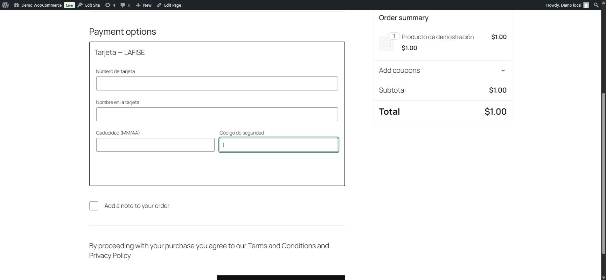
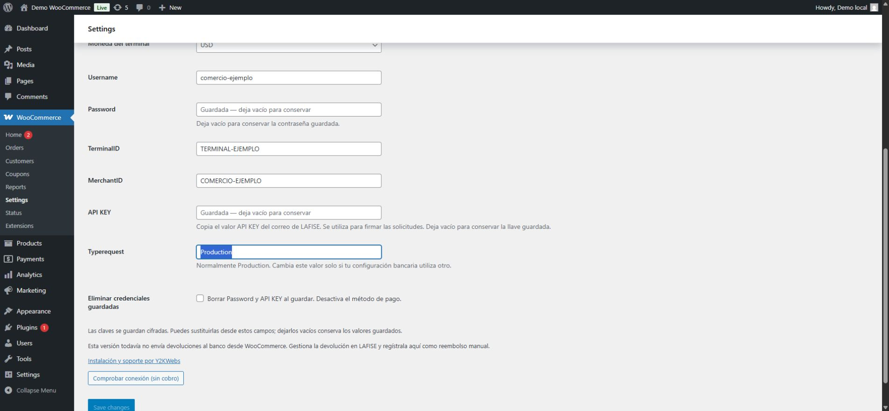

# Y2KWebs Gateway for LAFISE

Plugin independiente, gratuito y de código abierto para integrar los pagos REST de **LAFISE Costa Rica en WooCommerce**, desarrollado por [Y2KWebs](https://y2kwebs.com/). Sin registro obligatorio, telemetría ni anuncios en el checkout.

[Última release publicada: 0.2.0](https://github.com/Y2KWebs/y2kwebs-lafise/releases/tag/v0.2.0) · [Instalación y soporte profesional](https://y2kwebs.com/) · [Reportar un problema](https://github.com/Y2KWebs/y2kwebs-lafise/issues/new/choose)

**Versión 0.2.1 — preliminar, preparada para revisión y aún no publicada.** Pasarela funcional con pagos reales comprobados en WooCommerce. Con esta versión se ha verificado un pago de USD 1 con desafío 3DS manual completado por el titular, pedido pagado e intento aprobado. Las pruebas automatizadas utilizan un banco simulado; quedan escenarios específicos por ampliar, según los [resultados y limitaciones](docs/validation.md). Es un desarrollo independiente, no un plugin oficial de LAFISE; no se afirma una alianza ni respaldo del banco.

## Funcionalidades

- Credenciales del comercio configurables desde WooCommerce en el mismo orden y con las etiquetas del correo de LAFISE: Username, Password, TerminalID, MerchantID y API KEY. Password y API KEY se guardan cifrados.
- Checkout clásico y de bloques, cifrado JWE en el navegador y autenticación 3DS mediante fingerprint o desafío.
- Comprobación de firmas e importes, registro cifrado de intentos y deduplicación de ventas.
- Consulta de estado sin repetir el cobro. Los resultados inciertos mantienen el pedido en espera para revisión.
- APIs de pedidos de WooCommerce compatibles con HPOS y almacenamiento clásico.

**Limitaciones:** no hay devoluciones bancarias automáticas. La aprobación y el rechazo financieros directos de Sale siguen sin clasificación automática. Process3DS reconoce únicamente el rechazo `59` validado y sin autorización; los demás resultados no reconocidos permanecen en revisión. Queda por ampliar la cobertura de ramas 3DS, monedas, impuestos y navegadores, según la [cobertura documentada](docs/validation.md).

## Así se integra

Formulario de tarjeta dentro del checkout de bloques de WooCommerce:

Configuración con las mismas etiquetas y el mismo orden del correo de LAFISE:

Estas capturas proceden de un entorno local con banco simulado y datos ficticios. El aspecto general depende del tema de cada tienda.

## Requisitos e instalación

Requisitos mínimos del proyecto: WordPress 6.9, WooCommerce 10.3, PHP 8.2, OpenSSL, DOM, MySQL/MariaDB con GET_LOCK, HTTPS y enlaces permanentes. Las versiones efectivamente verificadas están en [validación](docs/validation.md); no se afirma compatibilidad con todas las versiones posteriores.

1. Instala WooCommerce y configura HTTPS, enlaces permanentes y la moneda de la tienda.
2. Para revisar 0.2.1, genera `dist/y2kwebs-lafise-0.2.1.zip` con `python scripts/package.py`. La release publicada continúa siendo 0.2.0. El ZIP de código fuente generado por GitHub no es el paquete de instalación verificado.
3. Sube el ZIP desde **Plugins → Añadir plugin → Subir plugin** y actívalo.
4. Abre **WooCommerce → Ajustes → Pagos → LAFISE — Y2KWebs** e introduce las credenciales de tu comercio.
5. Guarda y comprueba la conexión sin cobro. Esa comprobación verifica autenticación y formato de llave pública; no sustituye una prueba de pago.
6. Para una evaluación controlada, configura el modo **Pruebas** y un máximo bajo. Coordina los pagos según la [guía de pruebas](docs/pilot.md).

El modo Pruebas restringe usuarios e importe, pero **sus cobros son reales**. El modo Normal permite compradores invitados y registrados. Cada instalación utiliza una moneda y un terminal, sin conversión automática. Consulta la [configuración detallada](docs/configuration.md).

La tarjeta se cifra en el navegador antes de enviarse a WordPress. La autenticación bancaria y el resultado se presentan en una pantalla de la tienda. Excluye checkout, pagar pedido, admin-ajax y `/y2k-lafise/*` de caché y captura de cuerpos HTTP. Consulta las recomendaciones de [seguridad y retención](SECURITY.md).

## Documentación y desarrollo

- [Configuración y API administrativa](docs/configuration.md)
- [Arquitectura y flujo de pago](docs/architecture.md)
- [Pruebas bancarias controladas](docs/pilot.md)
- [Resultados de validación y pendientes](docs/validation.md)
- [Desarrollo y pruebas locales](docs/development.md)
- [Preparación de una release preliminar](docs/releasing.md)
- [Cómo contribuir](CONTRIBUTING.md)

El repositorio conserva tests y herramientas para que la comunidad pueda revisar y reproducir el comportamiento. El ZIP instalable incluye únicamente el plugin y la documentación de uso seleccionada. Los datos de prueba son ficticios; las suites locales interceptan las solicitudes bancarias y no realizan cobros. No ejecutes fixtures en tiendas reales.

## Soporte e instalación profesional

[Y2KWebs ofrece instalación, configuración y soporte profesional para WooCommerce](https://y2kwebs.com/), mediante acuerdo separado. El plugin se puede utilizar gratuitamente sin contratar estos servicios. Las comisiones y condiciones del comercio corresponden a su acuerdo con LAFISE.

Para incidencias, indica versiones, pasos de reproducción con datos ficticios y el código genérico de error. Nunca publiques claves, tarjetas, cookies, respuestas bancarias completas ni URLs con tokens. Para vulnerabilidades, sigue [SECURITY.md](SECURITY.md). El soporte comunitario no tiene SLA.

Licencia GPL-2.0-or-later. Las marcas LAFISE, KinPOS y WooCommerce pertenecen a sus respectivos titulares.
